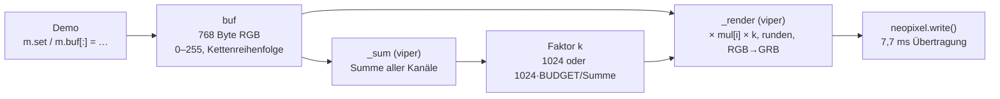
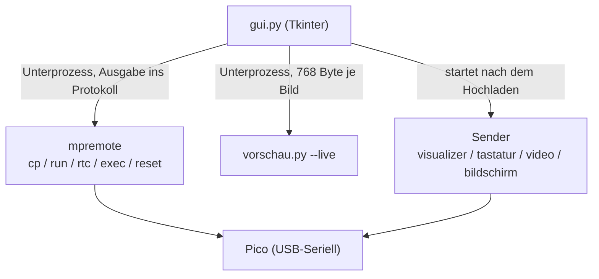

# Technischer Bericht: Pico LED-Matrix 16×16

Stand: Oktober 2026 · Autor: bonbon · Lizenz: [MIT](../LICENSE)

## 1. Zusammenfassung

Vier WS2812B-Matrizen mit je 8×8 LEDs bilden zusammen eine Anzeige mit 16×16 Pixeln. Ein Raspberry Pi Pico (RP2040) mit MicroPython steuert sie über eine einzige Datenleitung an. Strom kommt ausschließlich vom USB-Port des PCs.

Das Projekt besteht aus vier Teilen:

| Teil | Inhalt | Umfang |
|---|---|---|
| Bibliothek | `matrix.py`: Koordinaten, Dimmung, Helligkeitsausgleich, Strombremse | ca. 80 Zeilen |
| Demos | 26 Animationen in `demos/`, eine pro Datei, dazu ein Bild-Player | ca. 3 800 Zeilen |
| PC-Werkzeuge | GUI, Sender für Ton, Video, Bildschirm und Tastatur, Vorschau | ca. 2 000 Zeilen |
| Gehäuse | parametrisches OpenSCAD-Modell mit Pixelraster und Diffusor | 3 STL-Teile |

Die wichtigsten technischen Punkte:

- **USB reicht als Stromversorgung**, weil jede Farbe auf 16 von 255 begrenzt ist und eine Strombremse das ganze Bild dimmt, wenn zu viele LEDs hell sind.
- **Eine Matrix stammt aus einer anderen Charge** und ist etwa doppelt so hell. Ausgeglichen wird das per Farbkanal und mit gerundeter Festkomma-Rechnung, damit alle vier Matrizen ihre Farbstufen gleichzeitig wechseln.
- **Ein Bild auszugeben dauert etwa 8 ms.** Den größten Teil davon braucht das WS2812-Protokoll selbst (7,7 ms für 256 LEDs). Die Umrechnung läuft als nativer Code (`@micropython.viper`).
- **Alle PC-Pico-Protokolle bestehen nur aus druckbaren Zeichen**, sonst könnte ein Byte 0x03 das Programm auf dem Pico abbrechen.
- **Jede Demo läuft auch auf dem PC**, mit Attrappen für die Hardware. Das ergibt Vorschaubilder und eine Live-Vorschau in der GUI.

## 2. Hardware

### 2.1 Komponenten und Verdrahtung

| Komponente | Details |
|---|---|
| Controller | Raspberry Pi Pico (RP2040, 2 × Cortex-M0+ bei 125 MHz, 264 KB RAM, 2 MB Flash) |
| Anzeige | 4 × WS2812B-Matrix 8×8 (je 64 LEDs, 65 × 67 mm) |
| Datenleitung | GP22 → DIN Matrix 1 → DOUT → DIN Matrix 2 → … → Matrix 4 |
| Versorgung | 5 V von VBUS (USB), GND gemeinsam |

Die Kette läuft spaltenweise durch die Matrizen, innerhalb einer Matrix aber zeilenweise und nicht im Zickzack:

```
von vorne gesehen          LED-Index in der Kette
┌─────────┬─────────┐
│    1    │    3    │      Matrix m (0–3) = (x // 8) · 2 + (y // 8)
│ (0–63)  │(128–191)│      Index = m · 64 + (y mod 8) · 8 + (x mod 8)
├─────────┼─────────┤
│    2    │    4    │      (0,0) ist oben links
│(64–127) │(192–255)│
└─────────┴─────────┘
```

Die Formel steht in `matrix.xy()`. Alle Demos zeichnen in Bildschirm-Koordinaten und kennen die Verdrahtung nicht.

Der Pico gibt die Daten mit 3,3 V aus, die WS2812B erwartet bei 5 V eigentlich mindestens 3,5 V. Im Aufbau funktioniert das ohne Pegelwandler. Die README nennt Gegenmaßnahmen, falls es bei einem Nachbau flackert.

### 2.2 Strombudget

Eine WS2812B zieht bei vollem Weiß bis zu etwa 60 mA, 256 LEDs kämen also auf über 15 A. Ein USB-2.0-Port liefert 500 mA.

| Verbraucher | Strom (geschätzt) |
|---|---|
| Ruhestrom der LED-Treiber, 0,6–1 mA je LED, auch wenn sie aus sind | 150–250 mA |
| Leuchten bei `MAX = 16` (ca. 1,25 mA je LED im Mittel) | ca. 320 mA |
| Pico | ca. 25 mA |
| **Summe** | **ca. 500 mA** |

Begrenzt wird auf zwei Ebenen:

1. **`MAX = 16`:** Jeder Farbkanal wird von 0–255 auf 0–16 abgebildet, also etwa 6 % der vollen Helligkeit. Demos geben Farben trotzdem immer im vollen Bereich an.
2. **Strombremse `BUDGET`:** `show()` addiert alle 768 Kanalwerte. Liegt die Summe über `256 × 255`, wird das ganze Bild mit demselben Faktor gedimmt. Das entspricht einem Regenbogen, bei dem jede LED in der Summe 255 hat. Ein weißes Vollbild (Summe `256 × 765`) wird also auf ein Drittel gedimmt.

**Messung:** VSYS wurde über ADC3 (GP29) gemessen. Die Spannung fiel von 4,71 V (alle LEDs aus) gleichmäßig auf 4,61 V bei `MAX = 22`, ohne Einbruch. Die Grenze im Code liegt deshalb bei 22. Für mehr Helligkeit braucht es ein externes 5-V-Netzteil, das direkt an die Matrizen geht.

### 2.3 Unterschiedliche LED-Chargen

Matrix 1 ist deutlich heller als die anderen drei: Rot und Grün etwa doppelt so hell, Blau etwa 1,45-mal. Das zeigte sich erst an einfarbigen Testbildern. Ausgeglichen wird es über eine Tabelle `GAIN` je Matrix und Kanal:

```python
GAIN = ((0.5, 0.5, 0.69), (1, 1, 1), (1, 1, 1), (1, 1, 1))
```

Die Werte sind per Auge abgeglichen, nicht gemessen. Bei einem Nachbau mit anderen Matrizen gehören hier vermutlich andere Werte hin.

**Rundung:** Bei nur 17 Helligkeitsstufen (0–16) springt eine Farbe sichtbar von Stufe zu Stufe. Zuerst wurde abgerundet. Dann wechselte Matrix 1 mit dem halben Faktor ihre Stufen zu anderen Zeitpunkten als die anderen, und bei langsamen Farbverläufen sah es aus, als würde sie verzögert reagieren. Seitdem wird überall auf die nächste Stufe gerundet (`(x · f + 127) // 255`). Damit liegen die Umschaltpunkte aller Matrizen nahe beieinander.

## 3. Software auf dem Pico

### 3.1 Bildpipeline in `matrix.py`



- `buf` hält die Farben bereits in der Reihenfolge der LED-Kette. Demos, die einen festen Hintergrund haben, kopieren ihn mit `m.buf[:] = BG` in einem Schritt, statt 256-mal `set()` aufzurufen.
- Beim Import wird für jede der 768 Kanal-Positionen ein Faktor `mul[i] = round(MAX · GAIN · 1024 / 255)` vorberechnet (Festkomma ×1024). Damit kommt `show()` ohne Fließkomma aus.
- `_render` rechnet je Kanal `(src · mul · k + 2¹⁹) >> 20`, also beide Festkomma-Faktoren auf einmal, mit Rundung. Der Zwischenwert bleibt unter 2³¹ (255 · 1024 · 1024 ≈ 2,7 · 10⁸), passt also in die 32-Bit-Integer von viper.
- Das Ergebnis landet direkt im Puffer des `neopixel`-Treibers in GRB-Reihenfolge.

**Zeitbedarf:** Das WS2812-Protokoll überträgt 24 Bit je LED mit 1,25 µs pro Bit. 256 LEDs brauchen also 7,68 ms, dazu kommt die Reset-Pause. Gemessen braucht `show()` etwa 8 ms. Die Umrechnung selbst kostet also fast nichts, und mehr als etwa 120 Bilder pro Sekunde sind mit einer einzelnen Datenleitung physikalisch nicht möglich. Die Demos laufen mit 20–40 Bildern pro Sekunde.

### 3.2 Aufbau einer Demo

Jede Demo ist ein eigenständiges Skript, das als `main.py` auf den Pico kopiert wird und beim Einschalten startet. Das Muster:

```python
import time
import matrix as m

FRAME_MS = 40                       # Zeitbudget je Bild
BG = …                              # unbewegter Hintergrund, einmal vorberechnet

while True:
    t = time.ticks_ms()
    …                               # Zustand weiterrechnen, zeichnen
    m.show()
    time.sleep_ms(max(0, FRAME_MS - time.ticks_diff(time.ticks_ms(), t)))
```

Die Bildzeiten (`FRAME_MS`) liegen zwischen 25 ms (Visualizer) und 50 ms (Roboter). Nach den Projektregeln wird bei jeder neuen Demo auf dem Pico gemessen, ob Rechnen und `show()` zusammen unter `FRAME_MS` bleiben. Die einzelnen Messwerte sind nicht dokumentiert.

### 3.3 Leistungstechniken

Der RP2040 hat keine Gleitkomma-Einheit, und MicroPython-Bytecode ist etwa 100-mal langsamer als C. Eine Schleife über 256 Pixel mit `m.set()` und Fließkomma kostet schnell mehr als das ganze Bildbudget. Verwendet werden:

| Technik | Wo | Wirkung |
|---|---|---|
| `@micropython.viper` mit Ganzzahlen | 10 Demos und der Bild-Player, u. a. Feuer, Elemente, Erdblock, Pflasterstein, KI-Kern, Video | Pixelschleifen laufen als nativer Maschinencode |
| Festkomma statt Fließkomma | `matrix.py`, 3D-Demos | keine Software-Gleitkommaroutinen in der inneren Schleife |
| Hintergrund vorberechnen, `buf[:] = BG` | Aquarium, Bongo-Katze, Ente, Mampf, Shooter, Terminal | ein Speicherkopieren statt 256 Funktionsaufrufe |
| Paletten und Tabellen | Feuer (Wärme → Farbe), Video und Bild-Player (Index-Tabelle für die Umsortierung) | Farbrechnung durch Nachschlagen ersetzt |
| Koeffizienten je Fläche statt je Pixel | Erdblock, Pflasterstein | je Würfelseite 6 Koeffizienten pro Bild, die Texturkoordinate hängt dann linear von der Pixelposition ab |
| `gc.collect()` alle 8 Bilder | Elemente, KI-Kern, Mampf, Shooter, Terminal | kurze, planbare Pausen statt seltener langer |

viper hat Einschränkungen, die im Projekt mehrfach aufgefallen sind: keine verketteten Vergleiche (`0 <= x < 16`), kein `random`, nur 32-Bit-Integer ohne Überlaufschutz.

### 3.4 Speicher

Nach dem Start sind etwa 190 KB Heap frei. Trotzdem schlugen große Anforderungen fehl: Wenn eine Demo erst viele kleine Objekte erzeugt (Listen, Tupel, Strings), ist der Heap danach so zerstückelt, dass 4 KB am Stück nicht mehr zu bekommen sind. Deshalb legen alle Demos große `bytearray`s ganz am Anfang an, vor allem anderen.

Das Rennen von oben berechnet beim Start eine Strecke von 64 × 64 Pixeln (etwa 4 Sekunden, mit Ladebalken) und hält sie in drei `bytearray`s zu je 4 KB, die es als Erstes anlegt. Der Bild-Player `_bild.py` liest GIFs Bild für Bild aus dem Flash, damit auch 400 Bilder (ca. 300 KB) nicht in den RAM müssen.

### 3.5 Uhr ohne Batterie

Der Pico hat keine batteriegepufferte Echtzeituhr. Nach dem Einstecken steht die Zeit auf dem 1.1.2021, die Uhr-Demo zeigt dann blinkend `-- --`. Beim Hochladen setzt `mpremote rtc --set` die PC-Zeit, und `main.py` wird mit `exec "import main"` statt mit einem Reset gestartet, weil ein Reset die Zeit wieder löschen würde.

## 4. Kommunikation PC → Pico

### 4.1 Grundlage

Der Pico meldet sich am PC als USB-Seriell-Gerät an (`/dev/ttyACM*`, Hersteller-ID `0x2E8A`). Eine laufende Demo liest von `sys.stdin`, nicht blockierend über `select.poll()`, und zeichnet weiter, auch wenn nichts ankommt.

Die serielle Schnittstelle ist gleichzeitig die REPL von MicroPython. Ein Byte `0x03` (Strg+C) löst auf dem Pico einen `KeyboardInterrupt` aus und bricht die Demo ab. Deshalb gilt für alle Protokolle: **nur druckbare ASCII-Zeichen**. Binärdaten werden in Zeichen umkodiert.

Jede Demo mit Empfang hat einen **Demo-Modus**: Kommt eine Weile nichts an, animiert sie sich selbst. So funktioniert sie auch ohne PC und in der PC-Vorschau mit leerem stdin.

### 4.2 Protokolle

| Sender → Demo | Format | Rate |
|---|---|---|
| `visualizer.py` → `visualizer.py` | 16 Zeichen `'0' + Pegel` (Pegel 0–64 je Frequenzband), dann `\n` | ca. 40 Zeilen/s |
| `video.py`, `bildschirm.py` → `video.py` | `#`, 768 Zeichen `'0'`–`'o'` (6 Bit je Farbkanal, zeilenweise RGB), `\n` | bis 50 Bilder/s getestet |
| `tastatur.py` → `bongocat.py`, `ente.py` | je Tastendruck ein Zeichen für die Reihe, `l` beim Loslassen, jede Sekunde `.` oder `h` | ereignisgesteuert |

**Visualizer:** Der PC liest den Ton mit `parec` vom Monitor des Standard-Ausgangs (PipeWire oder PulseAudio), macht eine FFT über 2048 Werte und fasst sie in 16 logarithmisch verteilte Bänder von 40 Hz bis 16 kHz zusammen. Die Lautstärke wird automatisch nachgeregelt. Kommen 2 Sekunden lang keine Daten, zeigt der Pico eine Warte-Animation.

**Video:** ffmpeg dekodiert, schneidet zu und verkleinert flächengemittelt auf 16×16. Links von Videoseiten löst yt-dlp auf. Ein Bild sind 770 Byte, bei 50 Bildern pro Sekunde also etwa 38 KB/s. Der Pico dekodiert per viper und sortiert über eine vorberechnete Tabelle in die Kettenreihenfolge um. Alle 5 Sekunden meldet er seine Bildrate zurück. Kommt er nicht hinterher, lässt der Sender Bilder aus, damit das Video im Takt bleibt. 6 Bit je Kanal reichen, weil nach der Dimmung ohnehin nur 17 Stufen übrig bleiben.

**Bildschirm:** Unter Wayland läuft die Aufnahme über xdg-desktop-portal und PipeWire (GStreamer über python-gobject). Die Freigabe-Erlaubnis wird als Token gespeichert, damit der Auswahldialog nur einmal kommt. Unter X11 nimmt ffmpeg auf. Das Format ist dasselbe wie beim Video.

**Tastatur:** `tastatur.py` liest die Ereignisse direkt aus `/dev/input/event*`. Das geht unter Wayland und unabhängig vom aktiven Fenster, setzt aber voraus, dass der Benutzer in der Gruppe `input` ist. Das ist ein echtes Sicherheitsrisiko: Danach dürfen alle Programme dieses Benutzers die Tastatur mitlesen. Der Sender schickt deshalb so wenig wie möglich, nämlich nie die Taste selbst:

| Zeichen | Bedeutung |
|---|---|
| `q` | Taste in den oberen Reihen gedrückt (Esc, F-Tasten, Ziffern, Q-Reihe) |
| `a` | Taste in der mittleren Reihe (A-Reihe, Enter, Feststelltaste) |
| `y` | Taste in der unteren Reihe (Y-Reihe, Umschalt, Strg, Alt, Leertaste) |
| `k` | sonstige Taste (Pfeile, Ziffernblock, …) |
| `l` | eine Taste wurde losgelassen |
| `.` / `h` | Lebenszeichen, jede Sekunde: keine Taste gehalten / mindestens eine gehalten |

Die Reihe ergibt sich aus dem Linux-Tastencode. Der beschreibt die Position der Taste, nicht ihre Beschriftung, und gilt deshalb für QWERTZ und QWERTY gleich. Automatische Tastenwiederholung beim Halten wird ignoriert. Das Lebenszeichen `.` setzt den Haltezähler auf dem Pico zurück, so bleibt die Ente nicht hängen, falls ein `l` verloren geht.

### 4.3 Dateiformat `bild.bin`

Für eigene Bilder und GIFs rechnet die GUI alles auf dem PC um und lädt eine Datei hoch:

```
b"LEDB" | Anzahl Bilder (uint16 LE) | je Bild: Dauer in ms (uint16 LE) + 768 Byte RGB, zeilenweise
```

Der Player auf dem Pico liest die Bilder einzeln aus dem Flash und sortiert sie per viper in die Kettenreihenfolge um.

## 5. Software auf dem PC

### 5.1 Vorschau ohne Hardware

`tools/vorschau.py` führt eine Demo unverändert in CPython aus. Vorher ersetzt es die Module `matrix` und `micropython` durch Attrappen:

- `matrix` zeichnet in einen Puffer, `xy()` rechnet einfach zeilenweise.
- `@micropython.viper` wird zu einer Funktion, die nichts tut. Die Typ-Annotationen `ptr8`, `ptr16` und `ptr32` werden als Namen bereitgestellt, damit der Code überhaupt übersetzt wird.
- Im **Bildmodus** läuft die Zeit pro Bild genau 40 ms weiter, unabhängig von der Rechenzeit. Mit festem Zufalls-Startwert sind die Bilder reproduzierbar. Ausgabe ist ein PNG mit den gewünschten Bildnummern nebeneinander.
- Im **Live-Modus** (`--live`) läuft die echte Zeit, und jedes `show()` schreibt 768 Byte auf stdout. Davon liest die GUI.

Daraus folgen zwei Regeln für Demos: Sie dürfen nur die Funktionen von `matrix.py` nutzen, und sie müssen mit leerem stdin laufen, ohne in einer Schleife ohne `sleep_ms` zu hängen.

Die meisten Fehler einer neuen Demo (Ausrichtung, Farben, Größen) zeigen sich schon in dieser Vorschau. Nicht sichtbar sind dort Laufzeit, Speicher, Helligkeit und Farbwirkung auf den echten LEDs.

### 5.2 GUI

`tools/gui.py` ist eine Tkinter-Anwendung mit fünf Reitern: Demos, Bild/GIF, Video & Bildschirm, OS-Logo und Werkzeuge.



- **Pico-Zugriff** läuft immer über `mpremote` als Unterprozess (`uvx mpremote`, wenn es nicht installiert ist). Die Befehle laufen in einem Hintergrund-Thread, ihre Ausgabe kommt über eine Warteschlange ins Protokoll. Direkt nach einem Reset meldet sich der Pico 1–3 Sekunden lang neu am USB an. Typische Fehlermeldungen aus dieser Zeit erkennt die GUI und versucht es erneut.
- **Port-Konflikt:** Ein laufender Sender belegt die serielle Schnittstelle. Die GUI beendet ihn vor jedem `mpremote`-Aufruf.
- **Demo-Liste:** Jede Datei in `demos/`, die nicht mit `_` beginnt, erscheint automatisch. Namen und Beschreibungen kommen aus einer Tabelle in der GUI oder aus dem Kopfkommentar der Demo.
- **Bild/GIF:** Pillow skaliert (Einpassen, Zuschneiden, Strecken, wahlweise ohne Glättung für Pixel-Art) und hebt die Helligkeit für alle Bilder mit demselben Faktor an, damit GIFs nicht flackern.

### 5.3 Start und Aktualisierung

Die GUI kann sich ins Startmenü eintragen (`~/.local/share/applications/ledmatrix.desktop`). Der Eintrag startet `tools/starten.sh`. Das macht zuerst `git pull --ff-only` mit 10 Sekunden Zeitlimit und ohne Passwortabfrage, dann startet es die GUI. Das Ergebnis (aktuell, aktualisiert oder nicht möglich) übergibt es in einer Umgebungsvariable, und die GUI schreibt es ins Protokoll. Ohne Netz, auf einem anderen Branch oder bei lokalen Änderungen, die im Weg sind, startet die vorhandene Version.

## 6. Gehäuse

Das Gehäuse ist parametrisch in OpenSCAD beschrieben (`gehaeuse/gehaeuse.scad`) und besteht aus drei Teilen:

- **Frontrahmen:** 0,6 mm Diffusor, dahinter ein 8 mm tiefes Raster mit 16×16 Zellen. Die Wände sitzen jeweils zwischen zwei LEDs und damit auch auf den Stoßkanten der Matrizen. Gedruckt wird der Diffusor in Weiß, dann Filamentwechsel auf Schwarz, damit keine Zelle in die Nachbarzelle leuchtet.
- **Deckel:** 38 mm Innenraum, Eckhalter für die Platinen, ein Halter für den Pico mit USB-Durchbruch, Schlüssellöcher zum Aufhängen.
- **Messlehre:** eine dünne Platte mit Lochreihen von 8,0 bis 8,5 mm Abstand.

Außenmaß 148,6 × 152,6 × 50 mm. Details stehen in [`gehaeuse/README.md`](../gehaeuse/README.md).

**Erfahrungen aus dem ersten Druck:**

1. Die Halter in der Mitte und an den Seiten stießen gegen die Kabel hinter den Matrizen. Der Deckel ist jetzt 1 cm tiefer und hat nur noch Eckhalter.
2. Das Raster passte nicht. Ab der Mitte jeder Matrix lagen die LEDs neben den Zellen, der LED-Abstand ist also nicht wie angenommen 8 mm. Der echte Wert wird mit der Messlehre bestimmt und dann in `pitch_x` und `pitch_y` eingetragen.

## 7. Entwicklungsablauf

Neue Demos entstehen nach einem festen Ablauf (beschrieben im Claude-Code-Skill `.claude/skills/neue-demo/SKILL.md`):

1. Idee und Pixel-Art festlegen. Keine Nachbauten bestimmter Spiele oder Figuren, eigene Grafik und Namen.
2. Vorschau auf dem PC rendern und ansehen.
3. Auf dem Pico laufen lassen und die Bildzeit gegen `FRAME_MS` messen, bei Bedarf mit den Techniken aus 3.3 beschleunigen.
4. Auf der echten Matrix ansehen. Erst dann gilt eine Demo als fertig, weil Helligkeit und Farbwirkung in der Vorschau nicht zu beurteilen sind.
5. README, GUI-Eintrag und Vorschaubild ergänzen, dann committen.

Ein großer Teil des Codes ist zusammen mit dem KI-Assistenten Claude Code entstanden. Die Projektregeln dafür stehen in `CLAUDE.md`.

## 8. Grenzen und offene Punkte

| Punkt | Stand |
|---|---|
| LED-Abstand fürs Gehäuse | unbekannt, Messung mit der Lehre steht aus |
| Helligkeitsausgleich | per Auge abgeglichen, nur für diese vier Matrizen gültig |
| Helligkeit | auf ca. 6 % begrenzt, mehr nur mit Netzteil |
| Datenpegel 3,3 V an 5-V-LEDs | funktioniert hier, bei anderen Aufbauten evtl. Pegelwandler nötig |
| Uhrzeit | geht bei jedem Ausstecken verloren (keine RTC-Batterie) |
| Bildzeiten auf dem Pico | je Demo geprüft, aber nicht systematisch dokumentiert |
| PC-Werkzeuge | nur unter Linux getestet. Tastatur (`/dev/input`), Ton (`parec`) und Bildschirm (xdg-desktop-portal) sind Linux-spezifisch |
| Serielle Schnittstelle | immer nur ein Programm gleichzeitig: Sender oder `mpremote` |
| Tastatur-Sender | braucht die Gruppe `input` und erlaubt damit allen Programmen des Benutzers das Mitlesen der Tastatur |
