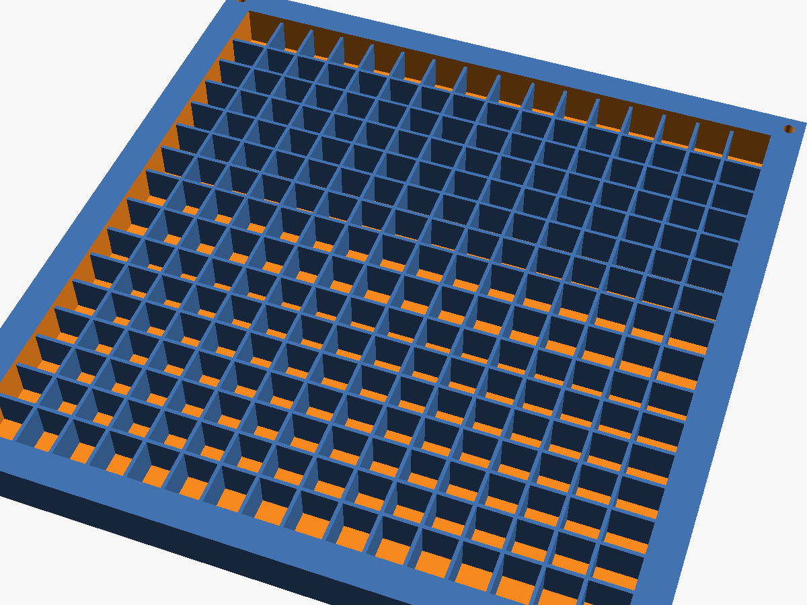
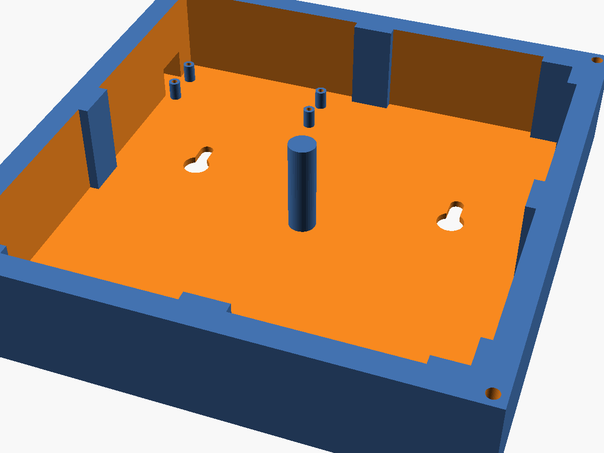

# Gehäuse zum 3D-Drucken

Gehäuse für die vier Matrizen und den Pico, parametrisch in OpenSCAD (`gehaeuse.scad`).
Die vier Matrizen liegen stumpf aneinander. Davor sitzt ein Pixelraster mit 16×16 Zellen und ein dünner Diffusor, so ergibt sich ein durchgehendes Bild.

> **Ungetestet.** Das Gehäuse wurde noch nicht gedruckt. Die Board-Maße sind nachgemessen, alles andere stammt aus Datenblättern oder ist geschätzt.
> Vor dem großen Druck lohnt sich ein kurzer Probedruck einer Ecke.

| Front (Raster) | Deckel (innen) |
|---|---|
|  |  |

## Aufbau, von vorne nach hinten

1. **Frontrahmen** (`front.stl`)
   - 0,6 mm Diffusor als Sichtfläche
   - dahinter das Pixelraster: 8 mm tief, 0,8 mm dicke Wände
   - Die Rasterwände sitzen jeweils mittig zwischen zwei LEDs und damit auch genau auf den Stoßkanten der Matrizen.
2. **Die 4 Matrizen**
   - liegen mit den LEDs zum Raster
   - Anordnung von vorne gesehen: 1 links oben, 2 links unten, 3 rechts oben, 4 rechts unten
3. **Deckel** (`deckel.stl`)
   - 28 mm Innenraum
   - Haltenasen drücken die Platinen an den Ecken und Seitenmitten ans Raster. Die Kantenmitten bleiben frei, dort liegen die Lötpads.
   - Die Ecke links oben ist frei für das Eingangskabel von Matrix 1.
   - Eine Stütze in der Mitte hält die Stelle, an der sich die 4 Platinen treffen.
   - Zwei Schlüssellöcher zum Aufhängen

**Pico:**
- sitzt links oben hinter Matrix 1, also nah am Eingangskabel
- liegt **umgedreht** auf 4 Abstandshaltern (6 mm): Die Bauteilseite zeigt zum Deckelboden, die nach unten angelöteten Stiftleisten zeigen zu den Matrizen.
- Die Dupont-Stecker haben dadurch nach oben Platz.
- Die Micro-USB-Buchse liegt in einem Durchbruch in der linken Wand.

## Maße (Standardwerte)

| | |
|---|---|
| Außenmaß | 144,6 × 148,6 mm |
| Tiefe | 40 mm (10 mm Front + 30 mm Deckel) |
| Matrix | 65 mm breit × 67 mm hoch, Platine ca. 3 mm mit LEDs |

## Material

- 4 × M3-Schraube, selbstschneidend, ca. 35 mm lang (maximal 38 mm). Sie gehen durch die Deckelecken in den Rahmen.
- 4 × M2×6, selbstschneidend, für den Pico. Sie werden von der Pin-Seite durch die Pico-Löcher in die Abstandshalter gedreht.

## Drucken

| Teil | Lage | Hinweise |
|---|---|---|
| `front.stl` | Sichtseite nach unten | Die ersten 0,6 mm in **Weiß** drucken, dann Filamentwechsel auf **Schwarz** (M600 auf 0,6 mm Höhe). Dann leuchtet keine Zelle in die Nachbarzelle. 0,2 mm Schichthöhe, keine Stützen. |
| `deckel.stl` | Boden nach unten | Keine Stützen nötig. Der USB-Durchbruch überbrückt 12 mm. |

Den Diffusor kann man auch weglassen (`diff_t = 0`) und stattdessen eine Streuscheibe davorsetzen, z. B. aus satiniertem Acryl oder Transparentpapier.

## Zusammenbau

1. Den Frontrahmen mit der Sichtseite nach unten hinlegen.
2. Die Matrizen mit den LEDs nach unten einlegen. Matrix 1 kommt dabei, von vorne gesehen, nach links oben. Weil der Rahmen umgedreht liegt, ist das jetzt **rechts oben**.
3. Den Pico in den Deckel schrauben, das LED-Kabel aufstecken und den Deckel aufsetzen.
4. Mit den 4 M3-Schrauben verschrauben.

## Anpassen

Alle Maße stehen oben in `gehaeuse.scad`. Die wichtigsten:

- `board_x`, `board_y`, `pitch_x`, `pitch_y`: Maße der Matrix und LED-Abstand. Bitte nachmessen.
- `grid_h`: Raster-Tiefe. Höher heißt weichere, gleichmäßigere Pixel.
- `cav`: Tiefe des Innenraums. Mit angelöteten Kabeln statt Dupont reichen etwa 15 mm.
- `tol`: Spiel um die Matrizen, falls sie zu stramm oder zu locker sitzen.

STL neu erzeugen:

```bash
openscad -o front.stl  -D 'teil="front"'  gehaeuse.scad
openscad -o deckel.stl -D 'teil="deckel"' gehaeuse.scad
```

## Offene Punkte

- **Nahtstelle oben/unten:** Bei 67 mm Board-Höhe und 8 mm LED-Abstand liegen die LEDs an der waagerechten Naht 11 mm statt 8 mm auseinander. Die Zellen dort werden deshalb etwas höher (9,5 mm).
  Wenn die LEDs nicht mittig auf dem Board sitzen, bitte den Abstand vom Board-Rand zur ersten LED messen. Das lässt sich dann einbauen.
- **Pico-Maße:** Die Maße kommen aus dem Datenblatt (51 × 21 mm, Löcher 47 × 11,4 mm). Die Lage der USB-Buchse ist geschätzt.
